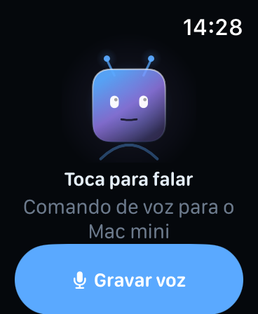
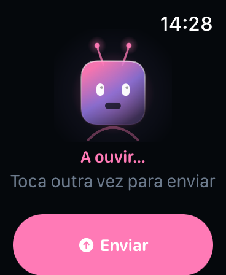
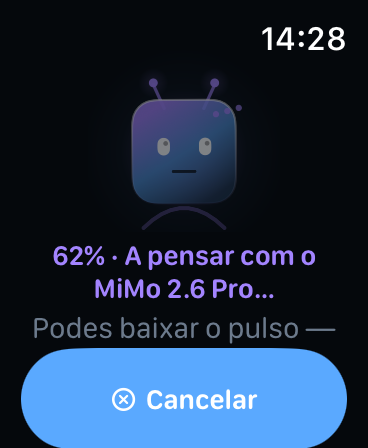
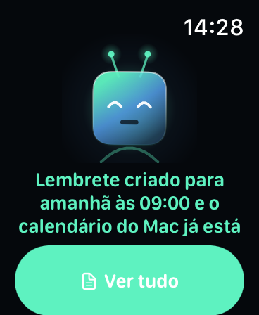

# Watch Pilot

[](https://github.com/frederico-kluser/watch-pilot/actions/workflows/ci.yml)
[](https://securityscorecards.dev/viewer/?uri=github.com/frederico-kluser/watch-pilot)
[](LICENSE)
[](#requirements)
[](#the-reasoning-step)

A voice assistant that lives on your wrist and thinks on your own Mac — with a
little animated character that changes pose with every state.

You speak into an **Apple Watch SE**. The audio goes to a **Mac mini M1** on your
network (or through your own Cloudflare tunnel), is transcribed **on-device** by
Apple's `SpeechAnalyzer`, is reasoned about by **Xiaomi MiMo 2.6 Pro** with a
maximum thinking budget, and the answer comes back to the watch — every request
authenticated with a fresh **RFC 6238 TOTP** code generated on the watch itself.

No always-on cloud server. No speech audio leaving your house.

```
Apple Watch SE                     Mac mini M1                      OpenRouter
┌──────────────────┐   HTTPS    ┌──────────────────────────┐      ┌──────────────┐
│ AVAudioRecorder  │ ─────────► │ FastAPI hub :8765        │ ───► │ MiMo 2.6 Pro │
│ 16 kHz mono AAC  │  X-Watch-  │  • TOTP verification     │      │ effort: max  │
│                  │   TOTP     │  • SpeechAnalyzer (CLI)  │ ◄─── │              │
│ animated avatar  │ ◄───────── │  • progress + notify API │      └──────────────┘
│ TOTP generator   │  progress  │  • iMessage / APNs relay │
└──────────────────┘            └──────────────────────────┘
       │                                    ▲
       └────────── or https://watch.kluser.me (Cloudflare tunnel) ──────┘
```

## What is actually working

Everything below was executed on the reference machine (Mac mini M1, macOS 27.0,
Xcode 27.1) — not estimated.

| Piece | Evidence |
| --- | --- |
| On-device transcription | `wtx-transcribe` transcribes a 6.4 s Portuguese voice memo in **~230 ms** (`SpeechAnalyzer`/`SpeechTranscriber`) |
| Reasoning | `xiaomi/mimo-v2.6-pro`, 96–162 reasoning tokens per turn, **$0.00015–0.0002** per turn |
| End-to-end | voice → upload → transcript → answer in **~8–12 s** through the public tunnel |
| Public subdomain | `https://watch.kluser.me` serves the hub; API calls pass with a watch-generated TOTP |
| watchOS app | builds unsigned for device **and** simulator; runs in the watchOS 27 simulator and **connects to the hub over TOTP** |
| Hub tests | `51 passed` (RFC 4226/6238 vectors, replay guard, auth, pipeline) |
| Boot | LaunchDaemon re-starts the hub **and** re-creates the `watch.kluser.me` route: hub live in 5 s, route in 20 s, edge 200 in 42 s after a cold start |

Screenshots of every state: [`docs/design/screenshots`](docs/design/screenshots).

| Idle | Listening | Thinking | Answer |
| --- | --- | --- | --- |
|  |  |  |  |

## Requirements

- **Mac mini M1** (or any Apple Silicon Mac) on **macOS 26+** — `SpeechAnalyzer` is
  a macOS 26 API. The reference runs macOS 27.0.
- **Xcode 26+** to build the watch app (27.1 used here).
- **Apple Watch SE** with watchOS 11+ (the app targets 11.0).
- An **OpenRouter API key** (`sk-or-v1-…`) for the reasoning step.
- Optional: a Cloudflare zone to publish the hub publicly (the reference uses
  `watch.kluser.me`).

A free **Personal Team** is enough to sideload the watch app; push notifications
(APNs) require a paid Apple Developer Program membership. Without it the hub falls
back to the iMessage/AppleScript relay.

## Quickstart

```bash
git clone https://github.com/frederico-kluser/watch-pilot.git
cd watch-pilot

# 1. hub: venv, transcription helper, secrets, LaunchDaemon
scripts/install-hub.sh

# 2. pair the watch: prints the otpauth:// URI and a QR code
server/.venv/bin/python scripts/wp.py pair

# 3. run a full voice command from the terminal
server/.venv/bin/python scripts/wp.py demo

# 4. optional: publish https://watch.kluser.me
scripts/publish.sh
```

Build and run the watch app:

```bash
cd apps/watch
xcodegen generate                       # regenerate WatchPilot.xcodeproj
xcodebuild -scheme WatchPilot -sdk watchos27.0 \
  CODE_SIGNING_ALLOWED=NO CODE_SIGNING_REQUIRED=NO build
```

For a real watch, open the project in Xcode, pick your Personal Team under
*Signing & Capabilities*, and run. See [`docs/SETUP.md`](docs/SETUP.md).

## API

Every `/api/*` route requires a TOTP code in `X-Watch-TOTP` (or `?totp=`), generated
from the shared secret with the Google Authenticator parameters
(SHA1 · 6 digits · 30 s · ±1 period). The browser dashboard uses the same secret
through a login form and a signed cookie.

| Method | Path | Purpose |
| --- | --- | --- |
| `POST` | `/api/v1/assistant/audio` | upload a voice memo (multipart `audio_file`) → `202` + `task_id` |
| `GET` | `/api/v1/assistant/progress/{task_id}` | poll a task: progress, transcript, answer, timings |
| `POST` | `/api/v1/notify` | push a notification to the user (the second endpoint of the hub) |
| `GET` | `/api/v1/inbox` | recent notifications |
| `POST` | `/api/v1/register-device` | register an APNs device token |
| `GET` | `/api/v1/tasks` | recent tasks |
| `GET` | `/api/v1/status` | redacted config + backend health |
| `GET` | `/__health` | unauthenticated liveness probe |
| `GET` | `/pair` | pairing page — **loopback only**, reveals the secret |

```bash
# a voice command from the CLI (synthesises speech, uploads, polls, prints)
server/.venv/bin/python scripts/wp.py ask "que reuniões tenho amanhã?"

# authenticated curl
curl -H "X-Watch-TOTP: $(server/.venv/bin/python scripts/wp.py totp | cut -d' ' -f1)" \
     https://watch.kluser.me/api/v1/status
```

## The reasoning step

`xiaomi/mimo-v2.6-pro` is called with `reasoning.effort = "max"`, fp8 quantisation,
and an explicit provider order (`deepinfra` → `xiaomi` → `novita`; `streamlake` is
excluded: 9.3 % uptime).

One measured caveat matters: **OpenRouter accepts `effort` but does not forward it**
— the provider receives a boolean `reasoning.enabled`, so `max` and `minimal` produce
comparable token counts. The real depth comes from the system prompt, which asks the
model to enumerate options and check its arithmetic before compressing the answer.
See [`docs/research/Q5-openrouter-mimo.md`](docs/research/Q5-openrouter-mimo.md).

## The face: why not a Memoji

Apple exposes **no public API** to create or animate Animoji/Memoji: the renderer
(`AvatarKit`) is a private framework, and watchOS ships neither ARKit nor RealityKit
(so no face-driven 3D avatar). What *is* public — `NSAdaptiveImageGlyph`, watchOS 11+ —
only displays a user's Genmoji/Memoji as a static glyph inside text.

So the character is ours: a vector robot drawn in `Canvas`, with the pose as **data**
(`AvatarPose`) per state — perked antennae while listening, eyes looking around while
thinking, `^^` eyes and a bounce on the answer, drooped antennae and X eyes on failure.
Evidence and sources: [`docs/research/Q8-memoji-animoji.md`](docs/research/Q8-memoji-animoji.md).
The animated GIF is [`docs/design/watchpilot-flow.gif`](docs/design/watchpilot-flow.gif).

## Design decisions worth knowing

The original specification for this project contained four assumptions that the
hardware and the SDKs do not support. They were replaced, not papered over — details
in [`docs/ARCHITECTURE.md`](docs/ARCHITECTURE.md):

1. **No 3-second background polling.** watchOS suspends the app when the wrist goes
   down; only a frontmost polling loop is real. Completion is notification-driven.
2. **`physical-therapy` is the only 1-hour background window** in
   `WKBackgroundModes` — and only one extended-session type is allowed per app.
3. **No speech framework on watchOS at all** (not even `SFSpeechRecognizer`): the
   watch must ship audio to the Mac mini.
4. **The zone TOTP gate would 401 the watch**, so the host is exempted at the edge
   and the hub enforces TOTP itself, per request.

## Repository layout

```
apps/watch/          standalone watchOS app (SwiftUI, XcodeGen)
apps/mac-tools/      wtx-transcribe — SpeechAnalyzer CLI
server/app/          FastAPI hub (config, security, transcribe, llm, notify, tasks, web)
server/tests/        51 tests
scripts/             wp.py CLI, installers, publish, screenshots
docs/                architecture, setup, infra, design, deep-research dossier
infra/               launchd + tunnel notes
```

## License

[MIT](LICENSE) © Frederico Kluser
