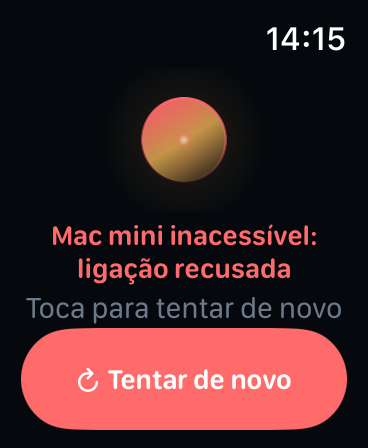
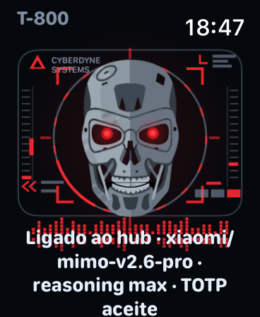

# Design

The interface is one screen with one job. On a 40 mm watch the expensive resources
are glance time and attention, not pixels — so the design optimises for "can I tell
what it is doing in under a second, and does it ever lie to me".

## Shape

Three bands, fixed order, never re-arranged:

```
┌──────────────────────┐
│        ◉ orb         │   optical target: state, colour, motion
│                      │
│   headline (1–4 ln)  │   what is happening, or the answer
│   "Ouvi: …"          │   what the hub actually heard
│   footnote           │   provenance: backend · duration
│                      │
│  ┌────────────────┐  │   one full-width action, label follows state
│  │   Gravar voz   │  │
│  └────────────────┘  │
└──────────────────────┘
```

The orb and the button never flex, so a long answer can never push the primary action
off the screen; the copy band scrolls inside its slice instead of clipping.

## State → colour → copy

| State | Orb | Headline | Action |
| --- | --- | --- | --- |
| idle | blue sphere, slow breath | "Toca para falar" | Gravar voz |
| listening | pink, 20 voice bars driven by mic power | "A ouvir…" | Enviar |
| uploading | amber, 3 orbiting sparks | "A enviar ao Mac mini…" | Cancelar |
| waiting | violet, progress ring | "62% · A pensar com o MiMo 2.6 Pro…" | Cancelar |
| answering | mint | the answer itself | Ver tudo |
| failed | red-orange | the error, in words | Tentar de novo / Ver estado |

## Principles applied (and where the audit pushed back)

A full audit against 195 research-backed principles is in
[`design/ux-audit.json`](design/ux-audit.json) with a readable summary in
[`design/ux-audit.md`](design/ux-audit.md). Score at review time: **43/100 (fair)**,
1 critical and 6 warnings. The critical finding and the four warnings that mattered
were fixed:

1. **Critical — the answer had no route to its full text.** It was being shrunk to
   ~9.4 pt and ellipsised. Now the summary band scrolls and *Ver tudo* opens the
   complete answer with its transcript and timings.
2. **Retry did not retry.** "Tentar de novo" called `resetSession()`, throwing the task
   away. Now, if a task is still pending, the button says *Ver estado* and re-polls;
   only a command with nothing pending starts a new recording.
3. **No way out of a 120-second wait.** The busy state now offers a real *Cancelar*.
4. **The transcript was invisible**, so a misrecognition looked like a confident wrong
   answer. `"Ouvi: …"` now appears as soon as the hub returns it.
5. **Dynamic Type.** Text uses semantic styles with a cap, instead of fixed 9.5 pt.

Two audit findings were deliberately **not** acted on, because they were wrong or
inapplicable: contrast is measured at 6.0–14.3:1 (no violation), and the 44 pt target
rule is already satisfied. The debug-only smoke-test copy is not user-facing.

## Motion

`TimelineView(.animation)` drives a `Canvas` — no `Timer`, no per-frame state change.
Reduce Motion pauses the timeline, and the state is still legible because colour and
copy carry it. The listening bars are the only element that moves with the voice;
everything else breathes slowly enough to read.

## Why the orb is not a button alone

Fitts's law says the biggest target should do the main thing, so the orb records — but
a bare tappable sphere is invisible affordance. The labelled full-width button below it
performs the same action in every state, so the screen is usable without discovering
that the orb is tappable. In the `failed` state they diverge on purpose: the button
recovers, the orb starts a new recording.

## Screenshots

Rendered from the simulator with `scripts/screenshot-states.sh`:

| | | |
| --- | --- | --- |
|  |  |  |
|  |  |  |

`07-real-progress.png` é diferente das restantes: o app foi lançado com
`-WPAttachTask <id>` e está a seguir uma tarefa **real** no hub (o texto "Ouvi: …"
é a transcrição verdadeira e os 45 % são o estado verdadeiro da tarefa). As imagens
01–05 usam `-WPDemoPhase <estado>` para congelar o orbe num estado; a 06 é a prova de
ligação por TOTP dentro do watchOS.
